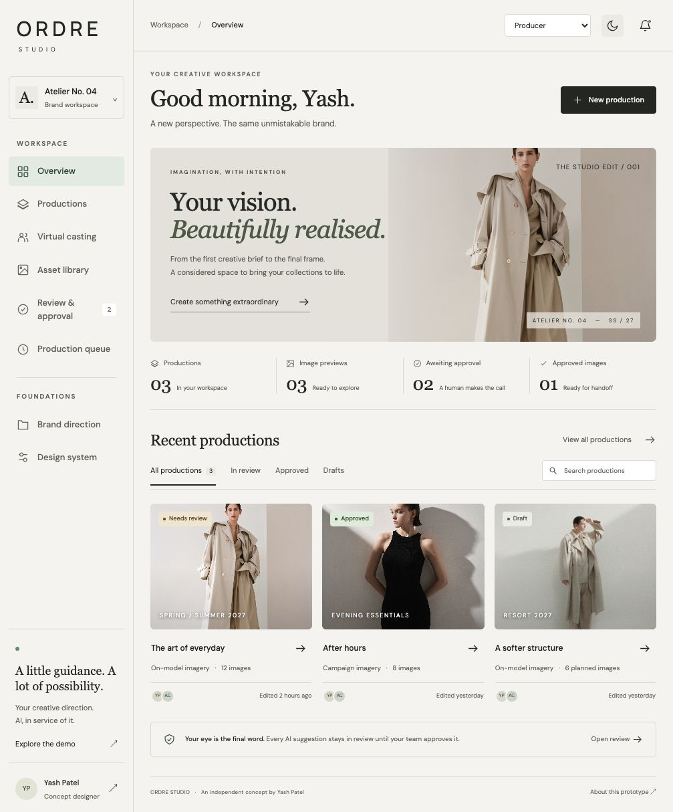

# ORDRE Studio — Luxury Fashion AI Workflow Concept

An independent product design and development concept by **Yash Patel**, exploring a luxury fashion image-production platform from brand direction to human approval. This is a portfolio prototype, not an official ORDRE product.

**[Open the live demo](https://yashvinodbhaipatel.github.io/ordre-ai-studio-demo/)**



## Experience

- Editorial overview and searchable, filterable productions.
- Guided production flow: creative brief → product photographs → casting → output selection.
- Virtual casting directions with a plain-language brief interaction.
- Simulated normal, slow, interrupted and safety-blocked generation states.
- Retry, edit-brief recovery, cancellation and resumable local production state.
- Review with colour, construction and quality checks; explicit human approval and review notes.
- Administrator, Producer, Operator and visitor interface previews.
- Brand direction settings, reusable component tokens, light/dark themes.
- Responsive layouts, semantic navigation, keyboard-accessible dialogs and reduced-motion support.
- CSV export of approved image decisions.

## Run locally

No install or build step is required. With Python 3:

```sh
python3 -m http.server 4173 --directory dist
```

Open `http://localhost:4173`. For a Node installation, any static web server can serve `dist/`.

## Files

| File | Purpose |
| --- | --- |
| `dist/index.html` | Semantic application shell |
| `dist/styles.css` | Responsive components, design tokens and themes |
| `dist/app.js` | Browser-local state, roles and workflow interactions |
| `docs/product-spec.md` | Scope, state transitions, role rules and acceptance criteria |
| `docs/usability-plan.md` | Proposed test tasks and evidence collection |
| `docs/asset-credits.md` | Reference photography credits and usage limitations |

## Important prototype boundaries

Generation is scripted and the displayed images are existing editorial references. Scores, collection counts and collaborators are illustrative. The app does not generate or clone people, transform uploaded products, process payments, call an AI provider, or enforce server-side authentication. Packshot and detail-crop options demonstrate workflow intent; their simulated result still uses reference imagery, not a newly rendered packshot.

Product uploads remain in memory in the current browser session. Production metadata, brand guidelines, reviews and display preferences are saved in `localStorage`. No team synchronization, GDPR certification or EU data residency is claimed. Remote reference images and Google Fonts make third-party requests; replace them with licensed, self-hosted assets before production use.

## Verification

Run `node tests/workflow-smoke.cjs` for dependency-free workflow and permission checks. The deployed demo was also checked in the browser for the production wizard, completion, approval gating, visitor view, dark mode and a 390px mobile layout. No browser errors were observed during that walkthrough.

## Production next steps

Connect an authenticated API, real asynchronous generation queue, licensed/synthetic casting assets, durable storage, authorization checks and versioned approval audit logs. Validate product fidelity with actual product/reference pairs and test with merchandisers, art directors and studio operators. Conduct a formal accessibility audit before claiming WCAG conformance.

See `docs/product-spec.md` for the detailed handoff.

**Designed and developed as a concept by Yash Patel.**
